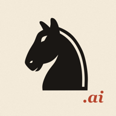
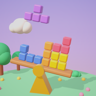
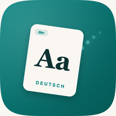
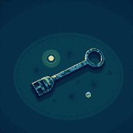
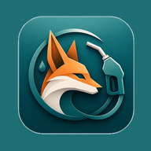
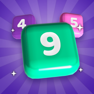

<h1 align="center">Hi, I'm Emre 👋</h1>

  Mobile engineer with 5+ years of building e-commerce apps in React Native. 
  Co-founder of <a href="https://dumpyapps.com"><b>dumpyapps</b></a>, where we design, build and ship our own games and apps for iOS and Android.

  
  
  

---

### What I work with

| | |
|---|---|
| **Mobile** | React Native, TypeScript, Expo, native modules in Swift and Kotlin, offline-first data with SQLite, localization |
| **E-commerce** | Production shopping apps: catalog, cart, checkout and payments, push notifications, analytics, App Store and Google Play releases |
| **Games** | Unity and C#, 2D and 3D mobile titles built entirely from code, CI-style batchmode builds |
| **Backend** | Node.js, Fastify, PostgreSQL, Redis, Drizzle, Zod; LLM integration with the Claude API; leaderboards, leagues and app APIs on self-managed Linux servers |
| **Web** | Next.js, Three.js, static landing and privacy sites |
| **Shipping** | Store listings, ASO, trailers, AdMob monetization, UMP consent, release automation |

### Shipped

12 titles live on the App Store and Google Play.

<table>
  <tr>
    <td></td>
    <td><b>Chess.ai</b> Play chess against an AI opponent you can talk to.</td>
    <td><a href="https://apps.apple.com/app/id6766441967">App Store</a></td>
  </tr>
  <tr>
    <td></td>
    <td><b><a href="https://teeter.dumpyapps.com/">Teeter</a></b> Falling blocks on a seesaw. Keep it level.</td>
    <td><a href="https://apps.apple.com/app/id6817526869">App Store</a> · <a href="https://play.google.com/store/apps/details?id=com.dumpyapps.teeter">Google Play</a></td>
  </tr>
  <tr>
    <td></td>
    <td><b><a href="https://holdtheridge.dumpyapps.com/">Hold the Ridge</a></b> Six days. One ridge. No retreat.</td>
    <td><a href="https://apps.apple.com/app/id6817094892">App Store</a> · <a href="https://play.google.com/store/apps/details?id=com.dumpyapps.holdtheridge">Google Play</a></td>
  </tr>
  <tr>
    <td></td>
    <td><b><a href="https://wortspur.dumpyapps.com/">Wortspur</a></b> German words, with der, die and das on every card.</td>
    <td><a href="https://apps.apple.com/app/id6813662014">App Store</a> · <a href="https://play.google.com/store/apps/details?id=com.dumpyapps.wortspur">Google Play</a></td>
  </tr>
  <tr>
    <td></td>
    <td><b><a href="https://lastbreath.dumpyapps.com/">Last Breath</a></b> Ten wrecks, ten keys, one father. A diving story.</td>
    <td><a href="https://apps.apple.com/app/id6813028938">App Store</a> · <a href="https://play.google.com/store/apps/details?id=com.dumpyapps.lastbreath">Google Play</a></td>
  </tr>
  <tr>
    <td></td>
    <td><b>Boomerman</b> Chain the blasts, clear ten houses a night.</td>
    <td><a href="https://apps.apple.com/app/id6809549771">App Store</a> · <a href="https://play.google.com/store/apps/details?id=com.dumpyapps.boomerman">Google Play</a></td>
  </tr>
  <tr>
    <td></td>
    <td><b><a href="https://tanken.dumpyapps.com/">Tankfuchs DE</a></b> Live German fuel prices at the nearest pump.</td>
    <td><a href="https://apps.apple.com/app/id6770056644">App Store</a> · <a href="https://play.google.com/store/apps/details?id=com.tanken.tankiq">Google Play</a></td>
  </tr>
  <tr>
    <td></td>
    <td><b><a href="https://prism.dumpyapps.com/">Prism</a></b> Aim a laser, bounce the mirrors, hit the heart.</td>
    <td><a href="https://apps.apple.com/app/id6769532787">App Store</a> · <a href="https://play.google.com/store/apps/details?id=com.dumpyapps.yansima">Google Play</a></td>
  </tr>
  <tr>
    <td></td>
    <td><b>Number Hunt</b> Connect adjacent cells to hit the number.</td>
    <td><a href="https://apps.apple.com/app/id6768426291">App Store</a> · <a href="https://play.google.com/store/apps/details?id=com.mernmania.sayiavi">Google Play</a></td>
  </tr>
  <tr>
    <td></td>
    <td><b>Tap 100</b> Tap 1 to 100, as fast as you can.</td>
    <td><a href="https://apps.apple.com/app/id6768061513">App Store</a> · <a href="https://play.google.com/store/apps/details?id=com.modifai.tap100">Google Play</a></td>
  </tr>
  <tr>
    <td></td>
    <td><b>DartX</b> Pub darts: 501, Cricket and a weekly league.</td>
    <td><a href="https://apps.apple.com/app/id6767266903">App Store</a> · <a href="https://play.google.com/store/apps/details?id=com.mernmania.dartx">Google Play</a></td>
  </tr>
  <tr>
    <td></td>
    <td><b>Crash Alert</b> A crash texts your location to people you trust.</td>
    <td><a href="https://play.google.com/store/apps/details?id=com.crashalert">Google Play</a></td>
  </tr>
</table>

### Open to

Freelance and full-time mobile roles, remote or relocation. If you have a game or an app in mind, [say hello](mailto:emrehrmn@gmail.com).
