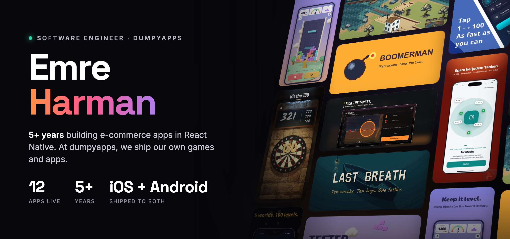

  
  
  

---

### Shipped

12 titles live on the App Store and Google Play.

<table>
  <tr>
    <td align="center" width="33%">
       
      <b>Chess.ai</b> 
      Play chess against an AI opponent you can talk to. 
      <a href="https://apps.apple.com/app/id6766441967">App Store</a>
    </td>
    <td align="center" width="33%">
       
      <b><a href="https://teeter.dumpyapps.com/">Teeter</a></b> 
      Falling blocks on a seesaw. Keep it level. 
      <a href="https://apps.apple.com/app/id6817526869">App Store</a> · <a href="https://play.google.com/store/apps/details?id=com.dumpyapps.teeter">Google Play</a>
    </td>
    <td align="center" width="33%">
       
      <b><a href="https://holdtheridge.dumpyapps.com/">Hold the Ridge</a></b> 
      Six days. One ridge. No retreat. 
      <a href="https://apps.apple.com/app/id6817094892">App Store</a> · <a href="https://play.google.com/store/apps/details?id=com.dumpyapps.holdtheridge">Google Play</a>
    </td>
  </tr>
  <tr>
    <td align="center" width="33%">
       
      <b><a href="https://wortspur.dumpyapps.com/">Wortspur</a></b> 
      German words, with der, die and das on every card. 
      <a href="https://apps.apple.com/app/id6813662014">App Store</a> · <a href="https://play.google.com/store/apps/details?id=com.dumpyapps.wortspur">Google Play</a>
    </td>
    <td align="center" width="33%">
       
      <b><a href="https://lastbreath.dumpyapps.com/">Last Breath</a></b> 
      Ten wrecks, ten keys, one father. A diving story. 
      <a href="https://apps.apple.com/app/id6813028938">App Store</a> · <a href="https://play.google.com/store/apps/details?id=com.dumpyapps.lastbreath">Google Play</a>
    </td>
    <td align="center" width="33%">
       
      <b>Boomerman</b> 
      Chain the blasts, clear ten houses a night. 
      <a href="https://apps.apple.com/app/id6809549771">App Store</a> · <a href="https://play.google.com/store/apps/details?id=com.dumpyapps.boomerman">Google Play</a>
    </td>
  </tr>
  <tr>
    <td align="center" width="33%">
       
      <b><a href="https://tanken.dumpyapps.com/">Tankfuchs DE</a></b> 
      Live German fuel prices at the nearest pump. 
      <a href="https://apps.apple.com/app/id6770056644">App Store</a> · <a href="https://play.google.com/store/apps/details?id=com.tanken.tankiq">Google Play</a>
    </td>
    <td align="center" width="33%">
       
      <b><a href="https://prism.dumpyapps.com/">Prism</a></b> 
      Aim a laser, bounce the mirrors, hit the heart. 
      <a href="https://apps.apple.com/app/id6769532787">App Store</a> · <a href="https://play.google.com/store/apps/details?id=com.dumpyapps.yansima">Google Play</a>
    </td>
    <td align="center" width="33%">
       
      <b>Number Hunt</b> 
      Connect adjacent cells to hit the number. 
      <a href="https://apps.apple.com/app/id6768426291">App Store</a> · <a href="https://play.google.com/store/apps/details?id=com.mernmania.sayiavi">Google Play</a>
    </td>
  </tr>
  <tr>
    <td align="center" width="33%">
       
      <b>Tap 100</b> 
      Tap 1 to 100, as fast as you can. 
      <a href="https://apps.apple.com/app/id6768061513">App Store</a> · <a href="https://play.google.com/store/apps/details?id=com.modifai.tap100">Google Play</a>
    </td>
    <td align="center" width="33%">
       
      <b>DartX</b> 
      Pub darts: 501, Cricket and a weekly league. 
      <a href="https://apps.apple.com/app/id6767266903">App Store</a> · <a href="https://play.google.com/store/apps/details?id=com.mernmania.dartx">Google Play</a>
    </td>
    <td align="center" width="33%">
       
      <b>Crash Alert</b> 
      A crash texts your location to people you trust. 
      <a href="https://play.google.com/store/apps/details?id=com.crashalert">Google Play</a>
    </td>
  </tr>
</table>

### What I work with

<table>
  <tr>
    <td width="120"><b>Mobile</b></td>
    <td>React Native, TypeScript, Expo, native modules in Swift and Kotlin, offline-first data with SQLite, localization</td>
  </tr>
  <tr>
    <td width="120"><b>E-commerce</b></td>
    <td>Production shopping apps: catalog, cart, checkout and payments, push notifications, analytics, App Store and Google Play releases</td>
  </tr>
  <tr>
    <td width="120"><b>Games</b></td>
    <td>Unity and C#, 2D and 3D mobile titles built entirely from code, CI-style batchmode builds</td>
  </tr>
  <tr>
    <td width="120"><b>Backend</b></td>
    <td>Node.js, Fastify, PostgreSQL, Redis, Drizzle, Zod; LLM integration with the Claude API; leaderboards, leagues and app APIs on self-managed Linux servers</td>
  </tr>
  <tr>
    <td width="120"><b>Web</b></td>
    <td>Next.js, Three.js, static landing and privacy sites</td>
  </tr>
  <tr>
    <td width="120"><b>Shipping</b></td>
    <td>Store listings, ASO, trailers, AdMob monetization, UMP consent, release automation</td>
  </tr>
</table>

### Open to

Freelance and full-time mobile roles, remote or relocation. If you have a game or an app in mind, [say hello](mailto:emrehrmn@gmail.com).
